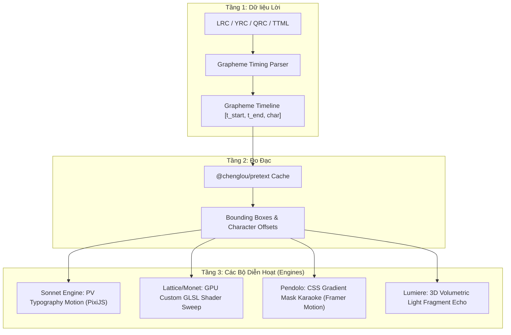

# 📜 KIẾN TRÚC HIỆU ỨNG CHỮ & HOẠT ẢNH LỜI BÀI HÁT TRONG FOLIA (FOLIA LYRICS ENGINE ARCHITECTURE)

> **Tài liệu đặc tả kiến trúc chuẩn (Architectural Specification & Reference Manual)** dành cho kỹ sư đồ họa và các AI Agent để hiểu sâu, kế thừa và xây dựng các bộ diễn hoạt lời bài hát (Lyric Motion Visualizers) chuẩn theo hệ thống Folia.

---

## 📑 MỤC LỤC
1. [Triết Lý Cốt Lõi & Bức Tranh Tổng Thể (Core Philosophy)](#1-triết-lý-cốt-lõi--bức-tranh-tổng-thể)
2. [Tầng 1: Xử Lý Dữ Liệu Thời Gian (Timing & Grapheme Segmentation)](#2-tầng-1-xử-lý-dữ-liệu-thời-gian)
3. [Tầng 2: Đo Đạc Kích Thước Chữ Không Trễ (Pretext Metric Engine)](#3-tầng-2-đo-đạc-kích-thước-chữ-không-trễ)
4. [Tầng 3: Engine PV & Động Lực Học Typography (Sonnet Motion Graphics)](#4-tầng-3-engine-pv--động-lực-học-typography)
5. [Tầng 4: Shaders Quét Karaoke WebGL 60FPS (Lattice & Monet Shaders)](#5-tầng-4-shaders-quét-karaoke-webgl-60fps)
6. [Tầng 5: Quét Mặt Nạ Gradient Bằng DOM/SVG (Pendolo Sweep)](#6-tầng-5-quét-mặt-nạ-gradient-bằng-domsvg)
7. [Tầng 6: Vang Vọng 3D Trong Chùm Sáng (Lumiere 3D Echo)](#7-tầng-6-vang-vọng-3d-trong-chùm-sáng)
8. [Hướng Dẫn Từng Bước Dành Cho AI Để Tạo Hiệu Ứng Mới](#8-hướng-dẫn-từng-bước-dành-cho-ai-để-tạo-hiệu-ứng-mới)

---

## 1. Triết Lý Cốt Lõi & Bức Tranh Tổng Thể

Trong các trình phát nhạc thông thường, lời bài hát thường chỉ là văn bản CSS cuộn dọc hoặc đổi màu (`color: red`). Trong **Folia**, lời bài hát được đối xử như một **thực thể điện ảnh (Cinematic Subject)** với 3 nguyên tắc bất biến:

1. **Seek-Safe & Deterministic (Tua an toàn tuyệt đối):** Mọi vị trí, góc xoay, độ mờ của từng chữ cái tại giây thứ $t$ là một hàm toán học thuần túy:
   $$\text{Frame}(t) = f(\text{Seed}, t, \text{LyricsData})$$
   Người dùng tua tới bất kỳ mili-giây nào, hình ảnh dựng ra phải giống hệt nhau mà không phụ thuộc vào trạng thái tích lũy của các frame trước.
2. **Zero GPU Re-allocation (Không cấp phát GPU trong Render Loop):**
   - Không sinh `new PIXI.Texture()` hoặc `document.createElement()` mỗi frame.
   - Sử dụng **Unit Quad Geometry** dùng chung và điều khiển quét sáng qua **GLSL Uniforms**.
3. **Phân Tách Vai Trò Ngữ Nghĩa (Typography Semantic Roles):**
   - Từ nhấn mạnh quan trọng nhất câu là **Hero** (kích thước $1.5\times - 2.5\times$).
   - Các từ phụ là **Semi-Hero** hoặc **Support**.
   - Các chi tiết kỹ thuật (timecode, mã vạch, dấu ngoặc mở) là **Decoration**.



---

## 2. Tầng 1: Xử Lý Dữ Liệu Thời Gian (Timing & Grapheme Segmentation)

### Nguồn: `src/utils/lyrics/graphemeTiming.ts`
Lời bài hát không chỉ dừng ở từng dòng hay từng từ, mà được phân rã sâu đến cấp **Grapheme Cluster** (ký tự đơn vị âm tiết, hỗ trợ cả tiếng Việt có dấu, Emoji, và chữ tượng hình CJK).

```typescript
export interface GraphemeTiming {
    char: string;
    startTime: number;
    endTime: number;
}
```

### Thuật toán nội suy thời gian cho từng chữ cái:
Khi một từ có mốc thời gian bắt đầu $T_{\text{start}}$ và kết thúc $T_{\text{end}}$, thời gian xuất hiện của chữ cái thứ $i$ trong từ có độ dài $N$ được chia tỉ lệ theo trọng số độ dài âm học hoặc chia đều:
$$t_{\text{char\_start}}(i) = T_{\text{start}} + \frac{i}{N} \cdot (T_{\text{end}} - T_{\text{start}})$$

Nhờ vậy, hiệu ứng quét chữ hoặc rơi chữ có thể diễn ra **mượt mà từng chữ cái** thay vì giật cục theo cả từ.

---

## 3. Tầng 2: Đo Đạc Kích Thước Chữ Không Trễ (Pretext Metric Engine)

### Nguồn: `src/components/visualizer/sonnet/sonnetTypographyLayout.ts`
Để xếp chữ nghệ thuật (xoay dọc, xoay nghiêng, đóng khung ruy-băng), engine không thể dùng `canvas.measureText()` liên tục vì sẽ làm rớt FPS từ 60 xuống 15.

Folia sử dụng thư viện `@chenglou/pretext` cùng **bộ nhớ đệm toàn cục khóa định danh**:

```typescript
const measureCache = new Map<string, number>();

export const measureText = (text: string, fontSpec: string, fontSize: number): number => {
    const key = `${fontSpec}|${fontSize}|${text}`;
    const cached = measureCache.get(key);
    if (cached !== undefined) return cached;

    // Đo đạc chính xác qua pretext và lưu cache
    const width = pretextMeasure(text, fontSpec, fontSize);
    if (measureCache.size < 20000) {
        measureCache.set(key, width);
    }
    return width;
};
```

---

## 4. Tầng 3: Engine PV & Động Lực Học Typography (Sonnet Motion Graphics)

### Nguồn: `src/components/visualizer/sonnet/`
`Sonnet` là visualizer phức tạp và nghệ thuật nhất của Folia, tái hiện trọn vẹn phong cách **Japanese Vocaloid PV**.

### 4.1. Hệ thống phân vai từ vựng (Typography Roles)
Mỗi cụm từ trong câu được chấm điểm ngữ nghĩa (`sonnetTypographyRoles.ts`):
- **Hero:** Từ có trọng âm, xuất hiện ở cao trào câu hoặc chứa cảm xúc mạnh. Font to nhất ($1.8\times$), font-weight 900.
- **Semi-Hero:** Các động từ/danh từ chính kế tiếp. Font vừa ($1.2\times$), font-weight 700.
- **Support:** Giới từ, mạo từ (`in`, `the`, `of`). Font nhỏ ($0.8\times$), font-weight 500.
- **Decoration:** Các yếu tố phụ trợ như số thứ tự `1 2 3`, dấu ngoặc kép `“ ”`, timecode `[ 00:00:26 ]`.

### 4.2. 7 Mẫu Cảnh (Shot Kinds) Tuyệt Đối
Sonnet gom các câu hát thành từng đoạn nhạc (`Paragraph`) và chia thành các shot quay:
1. `'type-impact'`: Toàn bộ từ khóa chính đập mạnh vào tâm màn hình cùng lúc với nhịp trống.
2. `'tracking-ribbon'`: Các dải ruy-băng chữ chạy ngang vô tận ngược chiều nhau như băng chuyền báo chí.
3. `'editorial-column'`: Bố cục cột báo chí thanh lịch, căn lề thẳng hàng, xen kẽ chữ dọc kiểu Nhật và chữ ngang.
4. `'fragment-collage'`: Các mảnh chữ vỡ trôi dạt ở các cao độ khác nhau.
5. `'mask-reveal'`: Chữ lộ dần từ sau các khối hình học.
6. `'poster-blocks'`: Bố cục khối áp phích Bauhaus đậm chất đồ họa.
7. `'quiet-tableau'`: Tĩnh lặng, chữ mờ ảo bay bổng trong các đoạn nhạc nghỉ (breath/bridge).

### 4.3. Các Đường Cong Easing Đậm Chất PV (`sonnetMotion.ts`)
Folia không dùng `ease-in-out` thông thường mà dùng **Exponential Easing** và **Elastic Bounce**:

```typescript
// 1. Cú đánh chữ siêu căng (High-tension PV Impact)
export const easeSonnetExpoOut = (value: number) => (
    value === 1 ? 1 : 1 - Math.pow(2, -10 * value)
);

// 2. Chữ nảy đàn hồi theo phách trống (Elastic Beat Bounce)
export const easeSonnetElasticOut = (value: number) => {
    const p = 0.3;
    return Math.pow(2, -10 * value) * Math.sin((value - p / 4) * (2 * Math.PI) / p) + 1;
};
```

### 4.4. Chi Tiết Khung Kỹ Thuật HUD (`sonnetFrameDecor.ts`)
Sonnet vẽ các góc mở không bao giờ khép kín (open-corner gap), kết hợp các dấu cộng `[ + ]`, vạch đo kỹ thuật và mã vạch ngẫu nhiên có hạt giống (`seed`), tạo phong cách Cyberpunk / Anime UI đặc trưng.

---

## 5. Tầng 4: Shaders Quét Karaoke WebGL 60FPS (Lattice & Monet Shaders)

### Nguồn: `src/components/app/lattice/lyrics/latticeLyricFilters.ts`
Trong thẻ bài phát nhạc (Lattice Card), lời bài hát hát tới đâu thì màu chữ đổi tới đó với độ biên mềm hoàn hảo. Thay vì vẽ lại Canvas 60 lần/giây, Folia biên dịch **một Fragment Shader GLSL chạy trực tiếp trên GPU**:

### GLSL Fragment Shader Quét Màu:
```glsl
in vec2 vUV;
in vec4 vColor;
out vec4 finalColor;
uniform sampler2D uTexture;
uniform vec4 uBase;           // Màu chữ chưa hát tới (thường mờ)
uniform vec4 uWord;           // Màu chữ đang hát (sáng rực)
uniform float uProgress;      // Tiến độ của từ (0.0 -> 1.0)
uniform float uFront;         // Vị trí mũi quét (X coordinate)
uniform float uSoftness;      // Độ mềm biên quét (Edge blur)
uniform float uPassed;        // Đã hát qua chưa (1.0 nếu xong)
uniform vec2 uGlyphRange;     // Giới hạn của ký tự trong texture
uniform vec2 uVerticalFade;   // Làm mờ dần cạnh trên dưới

void main() {
    float glyphAlpha = texture(uTexture, vUV).a;
    float x = vUV.x;
    
    // Tính toán độ mềm của mũi quét
    float start = uFront - uSoftness;
    float middle = uFront - uSoftness * 0.55;
    float mask = x < middle ? mix(1.0, 0.92, clamp((x - start) / max(0.00001, middle - start), 0.0, 1.0))
        : mix(0.92, 0.0, clamp((x - middle) / max(0.00001, uFront - middle), 0.0, 1.0));
        
    vec4 base = mix(uBase, uWord, uPassed);
    vec3 ink = mix(uBase.rgb, uWord.rgb, uProgress);
    float alpha = mask * step(0.000001, uProgress) * (1.0 - uPassed);
    float vertical = 1.0 - smoothstep(uVerticalFade.x, uVerticalFade.y, vUV.y);
    
    finalColor = vec4(ink * alpha + base.rgb * base.a * (1.0 - alpha), alpha + base.a * (1.0 - alpha)) 
                 * glyphAlpha * vertical * vColor;
}
```

---

## 6. Tầng 5: Quét Mặt Nạ Gradient Bằng DOM/SVG (Pendolo Sweep)

### Nguồn: `src/components/visualizer/pendolo/PendoloActiveLyricSweep.tsx`
Nếu không dùng WebGL Shader, làm sao để trình duyệt web render hiệu ứng quét chữ mượt mà không tốn tài nguyên?

`Pendolo` áp dụng kỹ thuật **CSS Mask Image Gradient** kết hợp `framer-motion`:

```tsx
const maskImage = useTransform(fillWidth, width => {
    const edgeSoftness = Math.min(Math.max(fontPx * 0.42, 8), 16);
    const paddedFillWidth = glowPaddingPx + width;
    return `linear-gradient(90deg, #000 0px, #000 ${Math.max(paddedFillWidth - edgeSoftness, 0)}px, rgba(0, 0, 0, 0.84) ${paddedFillWidth}px, transparent ${paddedFillWidth + edgeSoftness}px)`;
});
```

- Lớp dưới là văn bản màu nhạt.
- Lớp trên là văn bản màu sáng rực + filter phát sáng (Glow).
- Lớp trên được áp `mask-image` chạy từ trái sang phải theo `fillWidth`.

---

## 7. Tầng 6: Vang Vọng 3D Trong Chùm Sáng (Lumiere 3D Echo)

### Nguồn: `src/components/visualizer/lumiere/text/lyricEcho.ts`
Trong `Lumiere`, ca từ không chỉ đứng yên mà được "chiết xuất" các từ khóa:
- Khi một từ được hát lên, một **mảnh chữ rỗng khổng lồ (Hollow Glyph Sprite)** xuất hiện gần nguồn sáng.
- Mảnh chữ này trôi dạt dọc theo chùm sáng 3D (`ResolvedBeam`), xoay nghiêng theo trục ngẫu nhiên (`seed`), và tan biến sau khoảng 7 giây.
- Kỹ thuật này tạo nên cảm giác ca từ là những "linh hồn âm thanh" bay lượn trong không gian hòa nhạc.

---

## 8. Hướng Dẫn Từng Bước Dành Cho AI Để Tạo Hiệu Ứng Mới

Khi một AI Agent hoặc kỹ sư muốn thêm một Visualizer hoặc hiệu ứng chữ mới vào Folia, hãy làm đúng theo quy trình 5 bước:

### Bước 1: Tiếp nhận dữ liệu chuẩn từ Folia
Luôn nhận dữ liệu qua contract `Line` và `GraphemeTiming`:
```typescript
interface Line {
    startTime: number;
    endTime: number;
    fullText: string;
    graphemeTimings?: GraphemeTiming[];
    isChorus?: boolean;
}
```

### Bước 2: Đo đạc trước (Pre-measure)
Tuyệt đối không đo đạc trong `requestAnimationFrame`. Hãy chạy hàm đo qua pretext trước khi bắt đầu bài hát hoặc khi bài hát vừa commit (`useVisualizerSongCommit`).

### Bước 3: Chọn Pipeline Render phù hợp
| Nhu cầu hiệu ứng | Công nghệ đề xuất | Tham khảo module |
| :--- | :--- | :--- |
| **PV Anime / Kinetic Typography** | PixiJS Scene + Pretext Layout | `src/components/visualizer/sonnet/` |
| **Hát Karaoke quét từ mượt 60fps** | PixiJS Custom GLSL Shader | `src/components/app/lattice/lyrics/` |
| **Giao diện Web nhẹ / Đơn giản** | Framer Motion + CSS Mask | `src/components/visualizer/pendolo/` |
| **Không gian ánh sáng 3D / Thần tiên** | PixiJS 3D Beam + Floating Sprites | `src/components/visualizer/lumiere/` |

### Bước 4: Áp dụng Easing hàm mũ cho nhịp phách
Luôn dùng `easeSonnetExpoOut` khi chữ xuất hiện để có "lực đập" (impact punch), tránh dùng `linear` hoặc `ease-in` vì sẽ tạo cảm giác trễ nhịp so với âm nhạc.

### Bước 5: Đảm bảo tính Seek-Safe
Kiểm tra bằng cách nhảy ngẫu nhiên thanh thời gian (`currentTime = 5.2s`, `currentTime = 24.8s`). Toàn bộ vị trí chữ phải khớp tuyệt đối ngay lập tức mà không bị đè chữ của câu trước.

---
*Tài liệu được trích xuất và phân tích trực tiếp từ mã nguồn thực tế của dự án Folia (Folia Major v0.7).*
